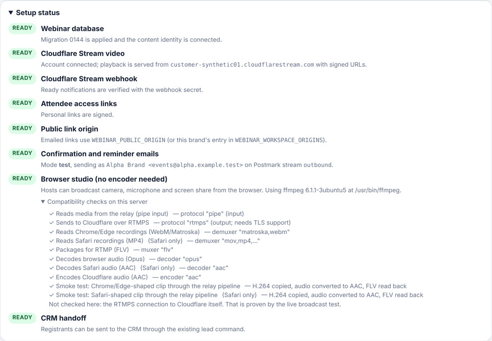
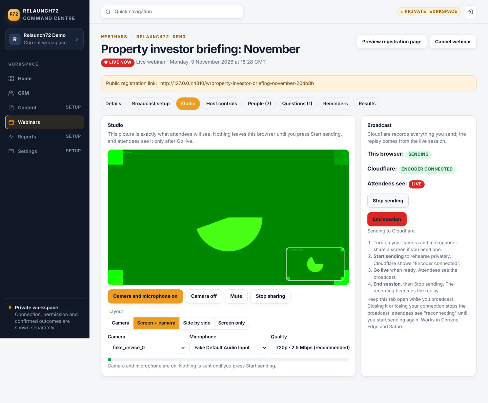

# Native webinars (Growth HQ → Webinars)

Native, multi-brand webinars inside the existing orchestrator. **Cloudflare Stream is the video layer only.**
Hosting, PostgreSQL, sign-in, brands, navigation, CRM, email and workers stay where they are. No YouTube,
Whereby or Zoom is used or substituted.

Status: source complete and integration-tested on a disposable PostgreSQL with fakes at the Cloudflare and
Postmark HTTP boundaries. **Not yet proven against a real Cloudflare account** (see *Smallest live test*).

## Where it is

* **Menu:** every signed-in portal user sees **Webinars** in the main navigation (Relaunch72, PropertyPredator
  Growth HQ and the MHP marketing workspace profiles). Owners and admins manage webinars; other roles get an
  honest "only an owner or admin can manage webinars" page.
* **Routes:** `/portal/webinars` (list, create, detail tabs: Details · Broadcast setup · Host controls ·
  People · Questions · Reminders · Results, plus registration preview and registrant CSV).
* **Attendees:** `/w/<public-key>` (registration), `/registered`, `/link` (email me my link), `/room`,
  `/calendar.ics`, on the canonical app host and on the MHP app host (`mhp/mount.ts`).
* **Cloudflare webhook:** `POST /api/webinars/stream-webhook`.
* **Browser studio:** the *Studio* tab of a live webinar, and its upload channel `GET /api/webinars/studio`
  (WebSocket, one-time ticket).

If the database migration or Cloudflare settings are missing, the page shows exactly which **names** are
missing and what each enables. Nothing is faked and nothing 404s.

## What it does

| Area | Behaviour |
|---|---|
| Kinds | **Live** (encoder → Cloudflare live input, recorded), **On demand** (uploaded video), **Scheduled presentation of a recording** (uploaded video shown at a set time, playhead locked to the clock, always labelled as a recording, never "live"). |
| Brands | One implementation for every workspace. Brand name, accent and support email come from `app.organization_branding`; colours are made WCAG-AA-safe automatically. Data is isolated by FORCE RLS per workspace. |
| Times | Owners type wall-clock time in the brand timezone; it is stored in UTC (DST-safe). Every room state and countdown is computed from the stored time and the server clock. |
| Room states | not started · waiting · host connecting (rehearsal) · live · interrupted · scheduled playing · processing · replay · replay expired · ended · cancelled · unavailable. Each has its own branded copy. |
| Host | Create live input (idempotent, crash-safe, reconcilable), reveal encoder settings only on request, private preview of what Cloudflare receives, **Go live / End session**, CTA reveal/hide, camera and microphone check (local only). |
| Access | Registration sets an HttpOnly cookie scoped to `/w/<key>`. Emailed links carry an HMAC token bound to that webinar, exchanged once for the cookie and removed from the URL. Typing a registered address never grants access; it emails the link instead. Playback URLs are short-lived RS256-signed Stream tokens. |
| Q&A | Moderated by default. 3 questions per 5 minutes, 20 per person. Pending questions are visible only to the asker. |
| CTA | Owner-defined. Manual mode is withheld from attendees entirely until the host reveals it; timed mode appears at a set minute. Clicks are recorded as clicks, never purchases. |
| Signals | Room opened (a page visit, **not** attendance), player started, 30-second watch intervals (rate-limited, ≤120 s each), CTA clicked, question submitted. No fake chat, no fake audience numbers. |
| Messages | Confirmation (also for anyone registering for the replay after the event), reminders (default 24 h and 1 h), reschedule notice, cancellation, replay available, access link. Each is a durable job with a dedupe key; a reschedule cancels stale reminders and queues new ones; a send interrupted mid-call is marked *unknown* and never resent; reminders whose time passed are skipped, never sent late. |
| CRM | Owner-triggered, idempotent handoff of registrants through the existing `CrmCommandService.createLead` (command key `webinar.<event>.<registration>`). The form's explicit marketing opt-in is passed as `opted_in`; everything else stays `unknown`. No new lead database. LeadRelay receives leads through the CRM as before. |
| Results | Registered, opened room, started player, observed minutes, CTA clicks, questions, CRM-linked, watched-at-least buckets, by source (UTM/referrer). |

## Live broadcasting: what Cloudflare can and cannot do

* **Used:** RTMPS (or SRT) from OBS, StreamYard, Restream or any encoder → a Cloudflare live input created
  with `recording.mode: automatic` and `requireSignedURLs: true` → attendees watch signed HLS. Cloudflare
  records the session; after **End session** the worker finds the recording (`GET /stream?live_input_id=`),
  and the webhook or poll promotes it to the replay.
* **Not used:** Cloudflare Stream's own WebRTC (WHIP/WHEP) ingest. In the API shapes reviewed it does not
  record and cannot be played as signed HLS, so it would give no replay and therefore cannot satisfy this recorded-HLS design.

### Browser studio: host with camera, microphone and screen share, no OBS

The *Studio* tab broadcasts straight from the host's browser into the same recorded live input, so recording,
replay, signed playback and every room state work exactly as with an encoder.

1. The page captures camera and microphone (`getUserMedia`) and, optionally, a screen, window or tab with its
   audio (`getDisplayMedia`). It composites them on a canvas: *Camera*, *Screen + camera* (inset),
   *Side by side* or *Screen only*. Mic mute, camera off, device pickers and a level meter are included.
   What the canvas shows is exactly what attendees see.
2. **Start sending** asks the portal for a one-time ticket (owner/admin, CSRF-checked, 60 s, single use) and
   opens a same-origin WebSocket. `MediaRecorder` sends H.264 video with 2-second keyframes and Opus audio in
   half-second chunks.
3. The server relay (`src/webinars/studio.ts`) runs one ffmpeg per broadcast: video **copied** (never
   re-encoded, so CPU stays small), audio to AAC, pushed over RTMPS to the webinar's Cloudflare live input.
   The stream key is looked up server-side and never reaches the browser; ffmpeg output is redacted before it
   is logged or shown.
4. Host flow on the same page: Start sending (private rehearsal; Cloudflare shows *Encoder connected*) →
   **Go live** → **End session** → Stop sending. The page shows the browser's state and Cloudflare's own view
   side by side, so a working browser is never mistaken for a confirmed broadcast.

Behaviour and limits:

* Browsers: Chrome, Edge and Safari on a computer. A browser that cannot record H.264 (for example Firefox) is
  told so and offered the encoder route; nothing is transcoded on the server.
* The compositor is driven by a worker timer, so switching to another tab or app to present keeps the
  broadcast running.
* Closing the tab or losing the connection stops sending; attendees see *Live · reconnecting* until the host
  presses Start sending again. Cloudflare records each connection separately, so a reconnect mid-session
  splits the recording (the replay uses the longest one; see Known gaps).
* Bounds: `WEBINAR_STUDIO_MAX_SESSIONS` concurrent relays per instance (default 1), `WEBINAR_STUDIO_MAX_MINUTES`
  per broadcast (default 240), 16 MB server-side backlog and 32 MB browser backlog before it stops with a plain
  "your upload cannot keep up" message, 4 MB frame and 8 MB message limits on the channel.
* Latency is HLS latency (roughly 10–20 s), as with an encoder.
* **Server requirement: the ffmpeg already on Render.** Render's native runtimes include FFmpeg at build time
  and at runtime (Render docs, *Native runtimes → Tools and utilities*, confirmed by Codex; render.com was not
  reachable from the build environment). The web service stays on `runtime: node`; no npm binary and no Docker.
  At start-up the server finds `ffmpeg` on PATH (or `WEBINAR_STUDIO_FFMPEG`, an optional override) and checks:
  pipe input, RTMPS output, WebM/Matroska and MP4 demuxers, FLV muxer, Opus and AAC decoders, AAC encoder,
  then a bounded local smoke test that pushes a Chrome-shaped and a Safari-shaped one-second clip through the
  relay's exact ffmpeg arguments to stdout and reads the FLV back (H.264 + AAC). No network and no provider are
  involved; it takes about half a second. The setup panel lists every check with its result, and the studio
  turns on only when all required checks pass (Safari's are reported separately).
* **What the probe cannot prove:** the RTMPS connection to Cloudflare and Cloudflare's recording of a studio
  broadcast. That is part of the live test below.
* Cloudflare's separate real-time products (Realtime SFU / RealtimeKit) would be a new paid product and were not used.

## Running webinars from Group HQ (one sign-in)

The owner runs both brands from **Group HQ** (`Martoon196/group-hq`, the separate founder app). Group HQ's
**Webinars** page lists every PP and MHP webinar and opens the host screen, studio, people list or editor on
the brand host **already signed in**. The video engine, registration pages, reminders, replays and CRM handoff
stay in this orchestrator on the brand hosts; Group HQ is the front door, not a second webinar system.

How the sign-in handoff works (`src/portal/group-hq-sso.ts`, route `/portal/auth/group-hq` on both hosts):

1. The founder is signed in to Group HQ (password + authenticator). A click signs a token with a secret only the
   two web services share: login email, brand, exact brand host, exact `/portal/...` path, issued/expiry (≤ 2
   minutes) and a nonce. The browser is redirected to `https://<brand host>/portal/auth/group-hq?t=<token>`.
2. This host verifies the HMAC, host, path and lifetime, refuses a nonce it has already consumed, and maps the
   email to a canonical user id from its own server-owned allowlist (`R72_GROUP_HQ_SSO_USERS`). A valid token for
   an email that is not listed is refused with the same neutral page as a bad token.
3. `app_private.create_group_hq_delegated_session` (migration 0147, `r72_security_definer`) refuses unless that
   user is an active owner or admin of the brand workspace (PP: `R72_GROUP_HQ_CRM_PP_WORKSPACE_ID`; MHP: the fixed
   marketing workspace, and only for the MHP marketing owner). It inserts the same `app.user_sessions` row a
   password login creates, with the host's own product audience, bounded to twelve hours. The ordinary cookie
   (`r72_portal` or `__Host-mhp_session`) is set and the browser lands on the requested page.

Nothing in the token is authority on its own; no browser value ever selects the workspace. A brand mismatch (an
MHP token presented to the PP host) is refused before any database call. Abuse admission uses the existing
`auth.sso` class.

Other pieces that make Group HQ the front door:

* **Webinar listing bridge** `GET /api/group-hq/webinars?brand=pp|mhp` (same bearer token as the CRM read bridge,
  `src/integrations/group-hq-crm/webinars.ts`): titles, times, status, registered and CRM-linked counts, the public
  registration link and the portal paths. Read-only, under the configured owner's own RLS context on the content
  identity, and only when that owner can manage the workspace. No attendee data, no secrets.
* **MHP host now serves `/portal/webinars`** (and the handoff route): `src/mhp/mount.ts` admitted only CRM,
  investors and LeadRelay before, so MHP owners could not manage MHP webinars on the MHP host. The MHP portal now
  composes `webinars`, `webinarSetup` and `webinarStudio`; RLS keeps each brand's webinars on its own workspace.
* **Automatic CRM handoff.** Each webinar has *Send every registrant to the CRM automatically* (on by default,
  stored as `settings.crmAutoHandoff`). The worker discovers workspaces with unlinked registrants through
  `app_private.webinar_crm_handoff_workspaces()` and sends them through the existing lead command **as the
  webinar's creator**, under that user's RLS context, so PP registrants become PP leads and MHP registrants become
  MHP marketing-workspace leads. Consent travels exactly as before (`opted_in` only with the explicit opt-in). A
  workspace whose handoff fails outright (for example no active default pipeline) is retried after ten minutes;
  the People tab's manual button still works for webinars that switch the automation off.
* **Email setup made copy-paste.** When a brand has no sender, the Webinars setup panel prints the exact
  `WEBINAR_EMAIL_SENDERS` entry for that workspace id (naming `MHP_POSTMARK_SERVER_TOKEN` for the MHP marketing
  workspace, `POSTMARK_SERVER_TOKEN` otherwise) and the current parse problems, instead of a generic hint.

Group HQ side (`docs/codex-handoff/11-GROUP-HQ-WEBINARS.md` carries the patch): `R72_SSO_SECRET` (same value as
`R72_GROUP_HQ_SSO_SECRET` here), `/webinars` page, `/webinars/open?brand=&path=` redirect, nav link, unit checks.

## Configuration (names only — never commit values)

| Name | Purpose |
|---|---|
| `CLOUDFLARE_ACCOUNT_ID` | Cloudflare account (32 hex). |
| `CLOUDFLARE_STREAM_API_TOKEN` | API token with **Stream: Edit** on that account. Server-side only. |
| `CLOUDFLARE_STREAM_CUSTOMER_CODE` | The `<code>` in `customer-<code>.cloudflarestream.com`. |
| `CLOUDFLARE_STREAM_SIGNING_KEY_ID` | `id` from `POST /accounts/{id}/stream/keys`. |
| `CLOUDFLARE_STREAM_SIGNING_JWK` | `jwk` from the same call (base64 RSA private JWK). |
| `CLOUDFLARE_STREAM_WEBHOOK_SECRET` | `secret` from `PUT /accounts/{id}/stream/webhook` (optional; without it the worker polls). |
| `WEBINAR_ACCESS_SECRET` | ≥32 random characters; signs attendee links. Rotating it invalidates every link. |
| `WEBINAR_EMAIL_MODE` | `off` (default) · `test` · `live`. |
| `WEBINAR_EMAIL_TEST_RECIPIENTS` | Comma-separated allow-list for test mode. |
| `WEBINAR_EMAIL_SENDERS` | JSON array, one entry per brand: `workspaceId`, `from`, `tokenEnv` (the **name** of the env var holding that brand's Postmark token), optional `replyTo`, `messageStream`. A brand with no entry is held, never sent from another brand. |
| `WEBINAR_PUBLIC_ORIGIN` / `WEBINAR_WORKSPACE_ORIGINS` | Origin for emailed links, globally / per brand (e.g. the MHP app host). |
| `WEBINAR_MAX_LIVE_INPUTS_PER_WORKSPACE` (2), `WEBINAR_MAX_UPLOAD_MINUTES` (240), `WEBINAR_RECORDING_RETENTION_DAYS` | Cost bounds. |
| `WEBINAR_WORKER_ENABLED` | `false` stops the in-process worker on an instance. |
| `WEBINAR_STUDIO_FFMPEG` | Path to ffmpeg for the browser studio (default `ffmpeg` on PATH). |
| `WEBINAR_STUDIO_MAX_SESSIONS` (1), `WEBINAR_STUDIO_MAX_MINUTES` (240) | Browser-studio bounds per instance. |
| `DATABASE_CONTENT_COMMAND_URL` | Existing `r72_content_command` login (reused; no new role). |
| `R72_GROUP_HQ_SSO_SECRET` | Group HQ sign-in handoff secret, 32–256 characters; the same value as `R72_SSO_SECRET` on Group HQ and shared with nothing else. Absent = handoff route answers 404, password sign-in unchanged. |
| `R72_GROUP_HQ_SSO_USERS` | JSON object, Group HQ login email → canonical portal user id (1–20 people). The server-owned allowlist; a token for any other email is refused. |
| `R72_GROUP_HQ_CRM_TOKEN`, `R72_GROUP_HQ_CRM_PP_*`, `R72_GROUP_HQ_CRM_MHP_*` | Existing CRM read-bridge settings, reused by `/api/group-hq/webinars` and (PP workspace) by the handoff. |

### Cloudflare one-time setup (owner)

1. Enable Stream on the existing Cloudflare account (pay-as-you-go: stored and delivered minutes). Do **not**
   move DNS, hosting or the database.
2. Create an API token scoped to *Account → Stream → Edit*.
3. `POST https://api.cloudflare.com/client/v4/accounts/{account_id}/stream/keys` → set the key id and JWK.
4. `PUT …/stream/webhook` with `notificationUrl = https://<app host>/api/webinars/stream-webhook` → set the secret.
5. Set the names above on Render, redeploy, open **Webinars**: the setup panel turns green.

API shapes were checked against the official `cloudflare` SDK 7.3.0 typings (live inputs, videos, keys,
webhooks, `live_input_id` list filter, tus direct upload headers) because developers.cloudflare.com was not
reachable from the build environment. Re-check against current docs during the live test.

## Data and release — current integration order

Creative Studio owns **0144**, and the separately released owner usage limits own
**0145_seo_owner_limits.sql** (SHA-256
`5cfa689e208bb4cf2197451dd04b00d2a214e1368887106e005b2e26e0a664df`). Native webinars is now
**0146_native_webinars.sql**, with unchanged SQL SHA-256
`dea9e16c2743b58b5901f95be06abcfc39d2237dc087b1c949478eb17357f3af`.
Payment 0142, inbox 0143, Creative Studio 0144 and the applied limits 0145 are preserved.

The 146 application is ready on the exact applied 145 ledger with only its reviewed
146 pending, and after 146. It refuses a 144 ledger with both limits and webinars
pending. Verify actual source/schema before starting a release.

The Group HQ handoff is **0147_group_hq_delegated_session.sql** (SHA-256
`7bd7caf7c10edfbb2fc0db2b2af09e9ba02550e7187f445f3c0f03b0a78f680e`, pinned in
`src/db/group-hq-sso-schema.ts`): additive, no table changes, two definer functions
(`create_group_hq_delegated_session`, `webinar_crm_handoff_workspaces`) and one execute grant
on `mhp_marketing_workspace_allowed` to the session definer. The 147 application is ready
on the exact applied 146 ledger with only 147 pending (handoff route 404, automatic CRM
handoff off until the function exists) and after 147. The released 146 binary stays ready
after exactly this 147 is applied (`test/db/runtime-readiness.test.ts`), so 146 remains the
recovery release for 147. Apply 147 only after 146 is released and proven.

**Already released binaries are not assumed to support rollback after 146.**
Prepare and prove a separate recovery artifact from the exact released limits/Studio
source, with an explicit readiness bridge for only this additive 146 and without
webinar routes or services. The prepared source is
`2c99f7b36042a5bfb8879b967310ac9f2897d8a2`, tree
`12ecc3f70f72f6c0b18a0c178d6351aae2e84814`, directly based on Studio
`9bf20d2d39539e9ef93b81380c6e2103373238bf`. Record the actual-role proof in the release
receipt before cutover. Until that artifact passes, production rollout remains blocked.
The former native-145 recovery `ba05116ace7b4ac53bbb98bbb31eb6a38bfb3ed5` is historical:
it does not accept the current limits-145 namespace and must not be used for recovery.

### Before production

The owner Cloudflare rehearsal remains a release gate. Run it first on a local or
separately approved isolated environment and disposable database, using the real
candidate. Never label fixture media as live-provider proof. A need for a temporary
Render rehearsal environment is a distinct setup/usage decision, not permission
to deploy the shared production app before the gate. Production Render FFmpeg
compatibility remains a post-rollout acceptance check; local proof cannot claim
that exact host was checked.

### Controlled rollout, after review and owner rehearsal

1. Confirm the exact owner limits 145 is actually applied and the shared release window
   is available. Preserve existing MHP/other brands' environment settings.
2. Retain and prove the exact prepared limits-145 recovery artifact. Deploy the exact
   capable 146 source to every strict schema consumer with new webinar mail and
   worker disabled. Verify `/ready` and the honest setup state before migration.
3. Apply only reviewed 146 with the migrator; verify the exact ledger/checksum and
   `/ready` on every consumer. Restart the app so its schema-probed service composes.
4. Verify the Webinars menu, owner permissions, actual Render FFmpeg checks and
   the approved configuration. Activate only the bounded webinar mode reviewed
   with the owner. Do not change Apollo, outreach or unrelated channels.

### Recovery and pause

Use the exact proved limits-145 recovery release above; never assume an older binary
accepts the advanced ledger. No down-migration or removal of recorded data.
`WEBINAR_EMAIL_MODE=off` and `WEBINAR_WORKER_ENABLED=false` are startup configuration:
after changing Render environment values the running process must be restarted or
redeployed before they take effect. Saving environment values alone does not pause
an already running worker. A provider call already in progress remains an uncertain
or settled operation, not an automatically refunded/cancelled one.

The worker never requeues a calling message after an exception; the existing lease
reaper classifies it unknown. Recording polling stays within its original two-day
deadline so a later longer segment can replace an early replay without a webhook.
Recordings are not stitched; only the longest observed segment is selected.

## Original Claude evidence (historical source; integrated gate is separate)

| Kind | What | Result |
|---|---|---|
| Source | `npm run typecheck`; unit tests `test/webinars.test.ts` (DST, room state machine, access tokens, config blockers, sender isolation, settings sanitising, Stream request shapes, error classes, tus host check, JWT verification, webhook HMAC window, contrast) | pass |
| Integration | `test/db/native-webinars.integration.test.ts` (service + worker on real roles/RLS) and `test/db/native-webinars-http.integration.test.ts` (real routers over HTTP: menu, CSRF, cross-site refusal, viewer/other-brand refusal, credential exposure, cookie scoping, live → replay, webhook replay, Q&A, CTA, CSV) on a disposable PostgreSQL | pass |
| Studio relay | `test/webinars-studio.test.ts`: real ffmpeg relays browser-style H.264/Opus WebM over the WebSocket into a local RTMP receiver standing in for Cloudflare; output is H.264 + AAC; the key never appears in messages or logs; tickets are single-use and same-origin; Cloudflare-only ingest; unmasked/oversized frames refused. HTTP: owner-only tickets, other brand and viewer refused, no ingest address or key in the page or JSON, honest page when ffmpeg is missing. | pass |
| Studio ffmpeg probe | `test/webinars-studio.test.ts`: the probe resolves ffmpeg from PATH (local: ffmpeg 6.1.1 at /usr/bin/ffmpeg, every check passing), and wrapper executables hiding one capability prove it names the exact failure: no RTMPS → unavailable; no MP4 demuxer → Chrome/Edge only; executable present but pipeline broken → unavailable. | pass |
| Studio in a real browser | Chromium (fake camera/mic, screen share) → Studio → Start sending → relay → local RTMP receiver: 14 s received as H.264 1280×720 + AAC, keyframes every ~2 s, no frame gap while the tab was in the background, Stop in ~0.3 s, no stream key in the page. Manual run (`test/manual-webinars-preview.ts --studio-ingest …`). | pass |
| Visual | `test/manual-webinars-preview.ts` + Playwright screenshots (nav, host screen, mobile live room, replay, setup-required state). Video in screenshots is a local labelled mock intercepted at the Stream hostname. | captured |
| Live provider | Real Cloudflare account | **not run** |

Run the database tests with the disposable-database guards (`TEST_DATABASE_URL`,
`TEST_DATABASE_RESET_CONFIRM=reset-disposable-branch`, `RELAUNCH72_DATABASE_INTEGRATION=explicit-disposable-run`).
The preview holds the same lease, so stop it before running the tests.

## Screenshots

Synthetic data on a disposable database; the video is a local mock labelled as such, not Cloudflare.

| | |
|---|---|
| Menu and list |  |
| Host controls, live |  |
| Broadcast setup (encoder; browser broadcasting explained) |  |
| Results with provenance |  |
| Second brand, same implementation |  |
| Setup required (no Cloudflare configured) |  |
| Mobile live room with revealed CTA |  |
| Mobile, autoplay refused (honest play button) |  |
| Mobile replay (second brand, contrast-safe teal) |  |
| Mobile, provider unavailable (no fake play button) |  |
| Setup status with the studio's compatibility checks (local ffmpeg) |  |
| Browser studio, sending (screen + camera inset; Chromium fake devices; Cloudflare state from the fake) |  |

## Smallest live test (needs the owner)

Bounded: one live input, one 5-minute private rehearsal, one owner-only registrant, `WEBINAR_EMAIL_MODE=test`.

1. Complete the Cloudflare one-time setup on the existing account (no new account or subscription).
2. Create a draft live webinar for the Relaunch72 workspace, publish it, register with an address on
   `WEBINAR_EMAIL_TEST_RECIPIENTS`.
3. Broadcast setup → Create live input. Then either stream from OBS (Show encoder settings), or open the
   **Studio**, turn on camera and microphone, share a screen and press Start sending, for 5 minutes. Check
   *Encoder connected* and the private preview. Before the studio run, confirm Setup status → Browser studio
   shows every required compatibility check passing on the rehearsal host. Check Render's
   actual runtime separately after the approved production rollout.
4. Go live, open the attendee link on a phone, confirm signed playback; reveal the CTA; ask and answer a question.
5. End session; confirm the replay appears (webhook or poll) and plays on the phone.
6. **Studio proof (separately recorded evidence):** repeat steps 3–5 from the Studio in Chrome with camera,
   microphone and a shared screen: Cloudflare shows *Encoder connected* while sending, attendees see the
   composite live, and the replay contains the studio picture and audio. This is the only proof of the
   RTMPS → Cloudflare → recording path for the studio.
7. Delete the live input and test video in Cloudflare afterwards if not needed. Expected cost: pennies of
   stored/delivered minutes.

## MHP: reversible cutover plan

The deployed MHP funnel (site `/webinar/live/` YouTube embed, `/api/mhp/subscribe` registration, 0136
applications, MHP marketing templates and `MHP_MARKETING_MODE`) is **not changed** by this branch.

1. After the live test passes, create the next MHP webinar natively in the MHP workspace (brand sender for the
   MHP workspace in `WEBINAR_EMAIL_SENDERS`, `WEBINAR_WORKSPACE_ORIGINS` → the MHP app host).
2. Run it in parallel once: the YouTube page stays the public default; the native room is shared only with a
   test cohort.
3. Review together: playback on phones, replay, reminders, CRM linkage, applications still arriving via 0136.
4. Cutover: point the MHP site's webinar CTA to the native `/w/<key>` page. Keep the YouTube configuration and
   templates in place for one further webinar.
5. Rollback at any point: point the CTA back to the YouTube page. No data migration is needed either way;
   native registrants already sit in the CRM.
6. Only after a reviewed successful native run, retire the YouTube configuration in a separate change.

## Known gaps

* Live Cloudflare acceptance (above). API shapes verified against SDK typings, not live responses.
* **Render's ffmpeg is verified only by the probe after deploy.** Locally (ffmpeg 6.1.1) every check passes.
  After the capable release is deployed, open Webinars → Setup status → *Compatibility checks on this server*.
  Contingency only if a required check fails there: report the failing check to Codex; the smallest
  reproducible alternative is Render's Docker runtime with `apt-get install -y ffmpeg` (Debian/Ubuntu ffmpeg
  builds pass every check), reviewed before any runtime change. `@ffmpeg-installer` npm binaries were rejected
  (ffmpeg 4.1 from 2018, install script forbidden by the supply-chain gate).
* The studio relay lives in the web process that issued the ticket. This is correct for the current single
  instance; running more web instances would need sticky sessions for `/api/webinars/studio`.
* A reconnect mid-session splits Cloudflare's recording. Whichever part is ready first becomes the replay and a
  longer part replaces it as soon as Cloudflare reports it (webhook or worker); joining the parts is not built.
* No live chat (deliberately: Q&A only, no fake chat).
* Rate limits for public registration/link requests are per process and per client address; with several web
  instances the effective limit multiplies. Room polling and signals are limited per registration (240 requests
  per minute each), so an office or campus behind one address is never throttled as a group; questions and
  signals are additionally bounded in the database.
* The original integration preserved Creative Studio 0144 and used native webinars
  0145. Following the separate production limits-0145 release, the future combined
  source preserves those exact bytes and uses native webinars 0146. The isolated
  rehearsal remains pinned to its separate native-0145 test database.
