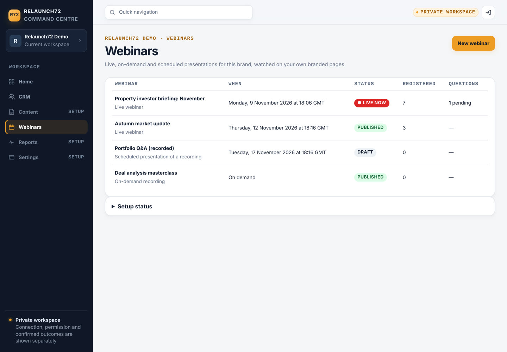
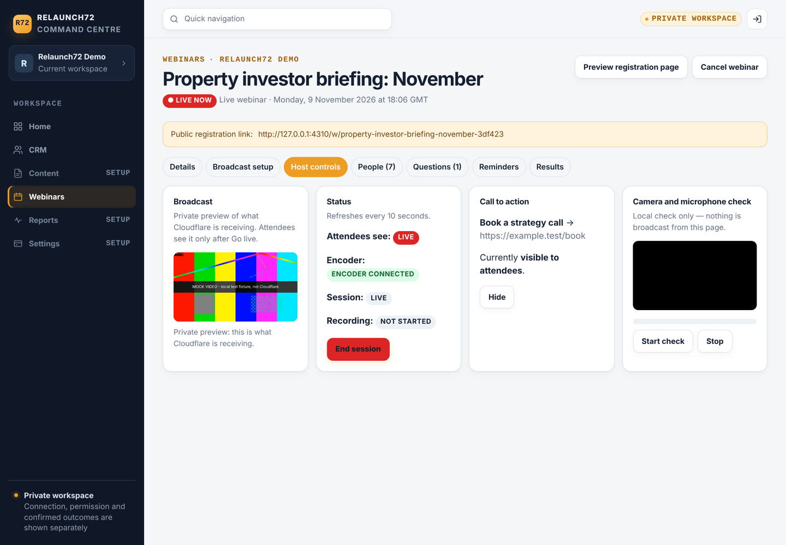
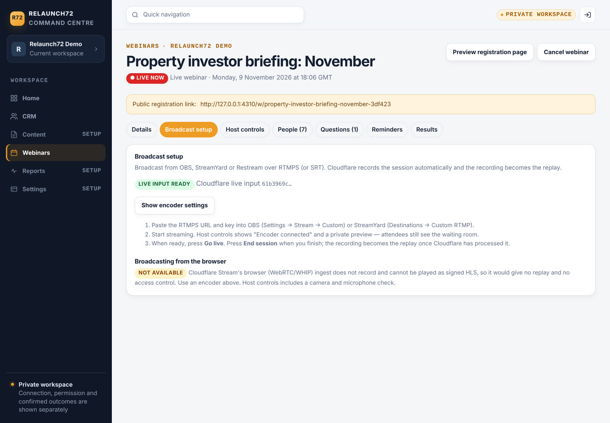
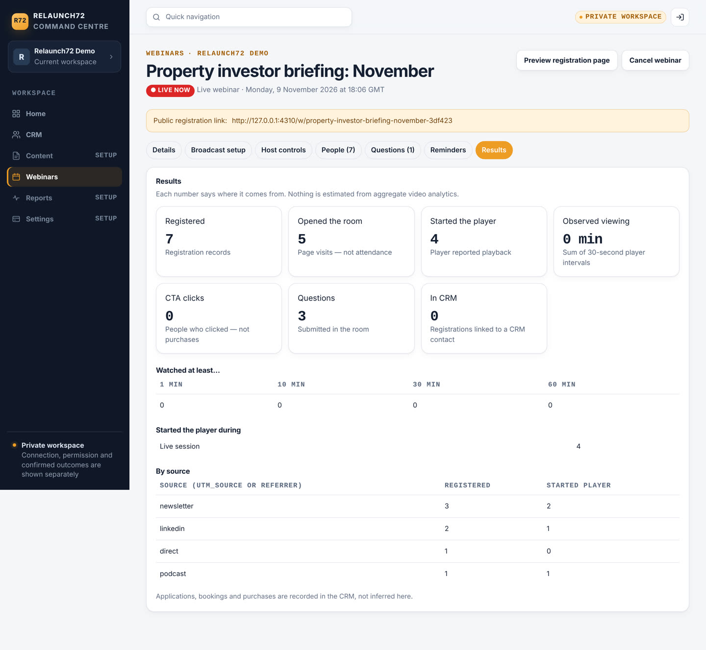
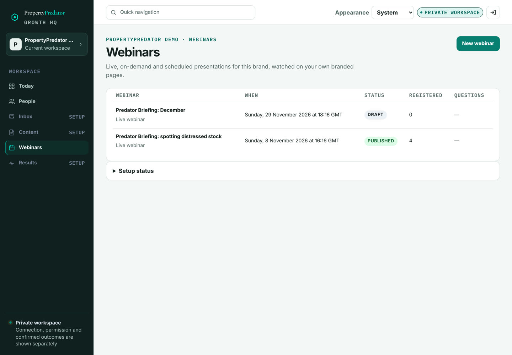
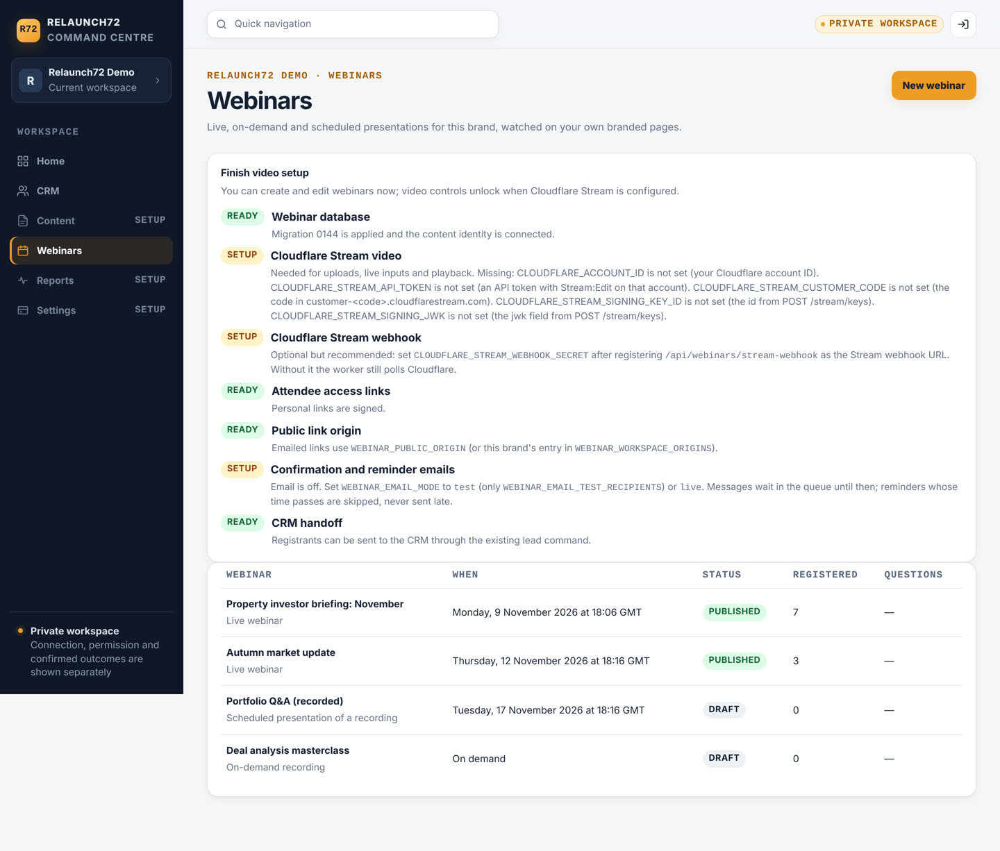
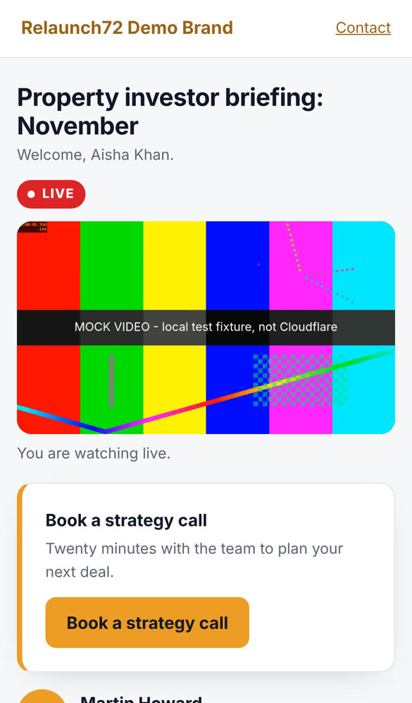
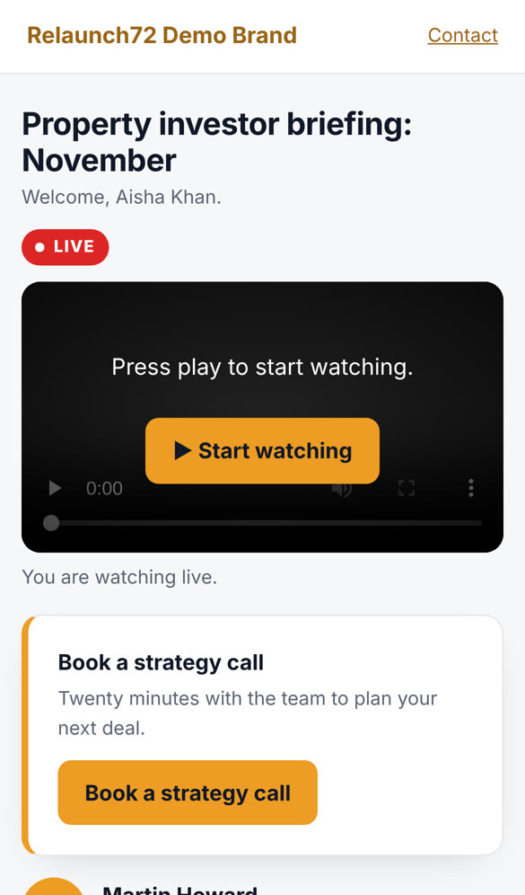
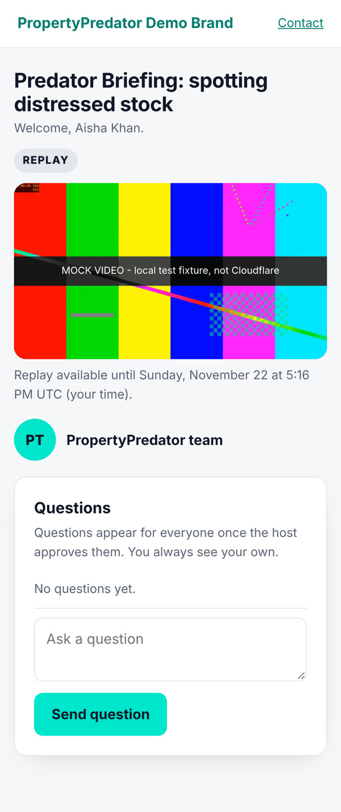
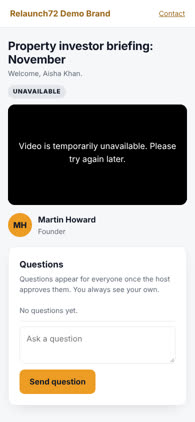

# Native webinars (Growth HQ → Webinars)

Native, multi-brand webinars inside the existing orchestrator. **Cloudflare Stream is the video layer only.**
Hosting, PostgreSQL, sign-in, brands, navigation, CRM, email and workers stay where they are. No YouTube,
Whereby or Zoom is used or substituted.

Status: source complete and integration-tested on a disposable PostgreSQL with fakes at the Cloudflare and
Postmark HTTP boundaries. **Not yet proven against a real Cloudflare account** (see *Smallest live test*).

## Where it is

* **Menu:** every signed-in portal user sees **Webinars** in the main navigation (Relaunch72, PropertyPredator
  Growth HQ and the MHP marketing workspace profiles). Owners and admins manage webinars; other roles get an
  honest "only an owner or admin can manage webinars" page.
* **Routes:** `/portal/webinars` (list, create, detail tabs: Details · Broadcast setup · Host controls ·
  People · Questions · Reminders · Results, plus registration preview and registrant CSV).
* **Attendees:** `/w/<public-key>` (registration), `/registered`, `/link` (email me my link), `/room`,
  `/calendar.ics`, on the canonical app host and on the MHP app host (`mhp/mount.ts`).
* **Cloudflare webhook:** `POST /api/webinars/stream-webhook`.

If the database migration or Cloudflare settings are missing, the page shows exactly which **names** are
missing and what each enables. Nothing is faked and nothing 404s.

## What it does

| Area | Behaviour |
|---|---|
| Kinds | **Live** (encoder → Cloudflare live input, recorded), **On demand** (uploaded video), **Scheduled presentation of a recording** (uploaded video shown at a set time, playhead locked to the clock, always labelled as a recording, never "live"). |
| Brands | One implementation for every workspace. Brand name, accent and support email come from `app.organization_branding`; colours are made WCAG-AA-safe automatically. Data is isolated by FORCE RLS per workspace. |
| Times | Owners type wall-clock time in the brand timezone; it is stored in UTC (DST-safe). Every room state and countdown is computed from the stored time and the server clock. |
| Room states | not started · waiting · host connecting (rehearsal) · live · interrupted · scheduled playing · processing · replay · replay expired · ended · cancelled · unavailable. Each has its own branded copy. |
| Host | Create live input (idempotent, crash-safe, reconcilable), reveal encoder settings only on request, private preview of what Cloudflare receives, **Go live / End session**, CTA reveal/hide, camera and microphone check (local only). |
| Access | Registration sets an HttpOnly cookie scoped to `/w/<key>`. Emailed links carry an HMAC token bound to that webinar, exchanged once for the cookie and removed from the URL. Typing a registered address never grants access; it emails the link instead. Playback URLs are short-lived RS256-signed Stream tokens. |
| Q&A | Moderated by default. 3 questions per 5 minutes, 20 per person. Pending questions are visible only to the asker. |
| CTA | Owner-defined. Manual mode is withheld from attendees entirely until the host reveals it; timed mode appears at a set minute. Clicks are recorded as clicks, never purchases. |
| Signals | Room opened (a page visit, **not** attendance), player started, 30-second watch intervals (rate-limited, ≤120 s each), CTA clicked, question submitted. No fake chat, no fake audience numbers. |
| Messages | Confirmation, reminders (default 24 h and 1 h), reschedule notice, cancellation, replay available, access link. Each is a durable job with a dedupe key; a reschedule cancels stale reminders and queues new ones; a send interrupted mid-call is marked *unknown* and never resent; reminders whose time passed are skipped, never sent late. |
| CRM | Owner-triggered, idempotent handoff of registrants through the existing `CrmCommandService.createLead` (command key `webinar.<event>.<registration>`). Service consent is kept separate from marketing opt-in. No new lead database. LeadRelay receives leads through the CRM as before. |
| Results | Registered, opened room, started player, observed minutes, CTA clicks, questions, CRM-linked, watched-at-least buckets, by source (UTM/referrer). |

## Live broadcasting: what Cloudflare can and cannot do

* **Used:** RTMPS (or SRT) from OBS, StreamYard, Restream or any encoder → a Cloudflare live input created
  with `recording.mode: automatic` and `requireSignedURLs: true` → attendees watch signed HLS. Cloudflare
  records the session; after **End session** the worker finds the recording (`GET /stream?live_input_id=`),
  and the webhook or poll promotes it to the replay.
* **Not used:** Cloudflare Stream's WebRTC (WHIP/WHEP) path. In the API shapes reviewed it does not record and
  cannot be played as signed HLS, so it would give no replay and no access control. The Broadcast setup tab
  says so plainly under *Broadcasting from the browser — Not available*; there is no working-looking button.

### Hosting from the browser (camera, microphone, screen share) with recording

Achievable without OBS, and without giving up recording or signed playback, by adding a **browser studio**
that feeds the same recorded live input:

1. The host page captures camera, microphone and screen (`getUserMedia` / `getDisplayMedia`) and composites
   them on a canvas (layouts: camera only, screen + camera inset, side by side).
2. `MediaRecorder` streams the composite as H.264/Opus chunks over a WebSocket to the orchestrator.
3. A per-session relay process (ffmpeg, video copied, audio to AAC) pushes RTMPS to the webinar's existing
   Cloudflare live input. Everything downstream is unchanged: recording, replay, signed HLS, room states.

Trade-offs to accept before building it: one ffmpeg process per live session on the app host (small CPU, the
host's upload bandwidth passes through our server), ffmpeg must be installed in the Render image, and latency
is HLS latency (roughly 10–20 s), as today. The alternative of Cloudflare's separate real-time products
(Realtime SFU / RealtimeKit) would mean a new paid product and was not evaluated here.

## Configuration (names only — never commit values)

| Name | Purpose |
|---|---|
| `CLOUDFLARE_ACCOUNT_ID` | Cloudflare account (32 hex). |
| `CLOUDFLARE_STREAM_API_TOKEN` | API token with **Stream: Edit** on that account. Server-side only. |
| `CLOUDFLARE_STREAM_CUSTOMER_CODE` | The `<code>` in `customer-<code>.cloudflarestream.com`. |
| `CLOUDFLARE_STREAM_SIGNING_KEY_ID` | `id` from `POST /accounts/{id}/stream/keys`. |
| `CLOUDFLARE_STREAM_SIGNING_JWK` | `jwk` from the same call (base64 RSA private JWK). |
| `CLOUDFLARE_STREAM_WEBHOOK_SECRET` | `secret` from `PUT /accounts/{id}/stream/webhook` (optional; without it the worker polls). |
| `WEBINAR_ACCESS_SECRET` | ≥32 random characters; signs attendee links. Rotating it invalidates every link. |
| `WEBINAR_EMAIL_MODE` | `off` (default) · `test` · `live`. |
| `WEBINAR_EMAIL_TEST_RECIPIENTS` | Comma-separated allow-list for test mode. |
| `WEBINAR_EMAIL_SENDERS` | JSON array, one entry per brand: `workspaceId`, `from`, `tokenEnv` (the **name** of the env var holding that brand's Postmark token), optional `replyTo`, `messageStream`. A brand with no entry is held, never sent from another brand. |
| `WEBINAR_PUBLIC_ORIGIN` / `WEBINAR_WORKSPACE_ORIGINS` | Origin for emailed links, globally / per brand (e.g. the MHP app host). |
| `WEBINAR_MAX_LIVE_INPUTS_PER_WORKSPACE` (2), `WEBINAR_MAX_UPLOAD_MINUTES` (240), `WEBINAR_RECORDING_RETENTION_DAYS` | Cost bounds. |
| `WEBINAR_WORKER_ENABLED` | `false` stops the in-process worker on an instance. |
| `DATABASE_CONTENT_COMMAND_URL` | Existing `r72_content_command` login (reused; no new role). |

### Cloudflare one-time setup (owner)

1. Enable Stream on the existing Cloudflare account (pay-as-you-go: stored and delivered minutes). Do **not**
   move DNS, hosting or the database.
2. Create an API token scoped to *Account → Stream → Edit*.
3. `POST https://api.cloudflare.com/client/v4/accounts/{account_id}/stream/keys` → set the key id and JWK.
4. `PUT …/stream/webhook` with `notificationUrl = https://<app host>/api/webinars/stream-webhook` → set the secret.
5. Set the names above on Render, redeploy, open **Webinars**: the setup panel turns green.

API shapes were checked against the official `cloudflare` SDK 7.3.0 typings (live inputs, videos, keys,
webhooks, `live_input_id` list filter, tus direct upload headers) because developers.cloudflare.com was not
reachable from the build environment. Re-check against current docs during the live test.

## Data and release

* **Migration `0144_native_webinars.sql`** — additive only: `app.webinar_events`, `webinar_registrations`,
  `webinar_signals`, `webinar_questions`, `webinar_jobs`, `webinar_provider_receipts`, FORCE RLS per
  workspace (pattern from 0131), definer functions for the public/attendee paths, grants to the existing
  `r72_content_command` only. SHA-256 `291934db5265d9e6d74cd336598f8731130a2b4869819067aac87ae96de01159`
  (pinned in `src/db/webinar-schema.ts`). Payment (0142) and inbox (0143) migrations are untouched.
* **Number coordination:** the unmerged Creative Studio branch also uses 0144. Whichever merges second renames
  its file to 0145, updates its schema constant, re-pins the checksum and the runtime-readiness clauses.
* **Runtime readiness:** a 144 release is ready on the exact 143 ledger (0144 pending) and after 0144; the 143
  release is ready after the exact reviewed 0144 (recovery clause). Any other ledger is refused.

### Deploy order

1. Deploy the capable release (this branch) to every consumer. With 0144 pending, the webinar service is not
   composed (schema probe) and `/portal/webinars` shows the setup state.
2. Run the migrator; verify `app_private.schema_migrations` shows 0144 with the checksum above and `/ready`.
3. Restart or redeploy so the webinar service composes; set Cloudflare and email names when ready.

### Recovery

* Roll back to the 143 release at any time after 0144: its readiness accepts the exact additive 0144; the
  tables are simply unused. No down-migration.
* Stop sending without a deploy: `WEBINAR_EMAIL_MODE=off` (jobs wait) or `WEBINAR_WORKER_ENABLED=false`.
* Jobs left `unknown` after a crash are never retried automatically; the Reminders tab lists them.
* An uncertain live-input creation is reconciled from the Broadcast tab (finds the input by job metadata)
  rather than creating a duplicate.

## Evidence (kept separate)

| Kind | What | Result |
|---|---|---|
| Source | `npm run typecheck`; unit tests `test/webinars.test.ts` (DST, room state machine, access tokens, config blockers, sender isolation, settings sanitising, Stream request shapes, error classes, tus host check, JWT verification, webhook HMAC window, contrast) | pass |
| Integration | `test/db/native-webinars.integration.test.ts` (service + worker on real roles/RLS) and `test/db/native-webinars-http.integration.test.ts` (real routers over HTTP: menu, CSRF, cross-site refusal, viewer/other-brand refusal, credential exposure, cookie scoping, live → replay, webhook replay, Q&A, CTA, CSV) on a disposable PostgreSQL | pass |
| Visual | `test/manual-webinars-preview.ts` + Playwright screenshots (nav, host screen, mobile live room, replay, setup-required state). Video in screenshots is a local labelled mock intercepted at the Stream hostname. | captured |
| Live provider | Real Cloudflare account | **not run** |

Run the database tests with the disposable-database guards (`TEST_DATABASE_URL`,
`TEST_DATABASE_RESET_CONFIRM=reset-disposable-branch`, `RELAUNCH72_DATABASE_INTEGRATION=explicit-disposable-run`).
The preview holds the same lease, so stop it before running the tests.

## Screenshots

Synthetic data on a disposable database; the video is a local mock labelled as such, not Cloudflare.

| | |
|---|---|
| Menu and list |  |
| Host controls, live |  |
| Broadcast setup (encoder; browser broadcasting explained) |  |
| Results with provenance |  |
| Second brand, same implementation |  |
| Setup required (no Cloudflare configured) |  |
| Mobile live room with revealed CTA |  |
| Mobile, autoplay refused (honest play button) |  |
| Mobile replay (second brand, contrast-safe teal) |  |
| Mobile, provider unavailable (no fake play button) |  |

## Smallest live test (needs the owner)

Bounded: one live input, one 5-minute private rehearsal, one owner-only registrant, `WEBINAR_EMAIL_MODE=test`.

1. Complete the Cloudflare one-time setup on the existing account (no new account or subscription).
2. Create a draft live webinar for the Relaunch72 workspace, publish it, register with an address on
   `WEBINAR_EMAIL_TEST_RECIPIENTS`.
3. Broadcast setup → Create live input → Show encoder settings → stream from OBS for 5 minutes. Check Host
   controls shows *Encoder connected* and the private preview.
4. Go live, open the attendee link on a phone, confirm signed playback; reveal the CTA; ask and answer a question.
5. End session; confirm the replay appears (webhook or poll) and plays on the phone.
6. Delete the live input and test video in Cloudflare afterwards if not needed. Expected cost: pennies of
   stored/delivered minutes.

## MHP: reversible cutover plan

The deployed MHP funnel (site `/webinar/live/` YouTube embed, `/api/mhp/subscribe` registration, 0136
applications, MHP marketing templates and `MHP_MARKETING_MODE`) is **not changed** by this branch.

1. After the live test passes, create the next MHP webinar natively in the MHP workspace (brand sender for the
   MHP workspace in `WEBINAR_EMAIL_SENDERS`, `WEBINAR_WORKSPACE_ORIGINS` → the MHP app host).
2. Run it in parallel once: the YouTube page stays the public default; the native room is shared only with a
   test cohort.
3. Review together: playback on phones, replay, reminders, CRM linkage, applications still arriving via 0136.
4. Cutover: point the MHP site's webinar CTA to the native `/w/<key>` page. Keep the YouTube configuration and
   templates in place for one further webinar.
5. Rollback at any point: point the CTA back to the YouTube page. No data migration is needed either way;
   native registrants already sit in the CRM.
6. Only after a reviewed successful native run, retire the YouTube configuration in a separate change.

## Known gaps

* Live Cloudflare acceptance (above). API shapes verified against SDK typings, not live responses.
* Browser studio (camera/mic/screen without OBS) is designed above, not built.
* No live chat (deliberately: Q&A only, no fake chat).
* Rate limits for public registration/link requests are per process; with several web instances the effective
  limit multiplies (database-backed limits cover questions and signals).
* Creative Studio migration-number collision must be resolved at merge time.
